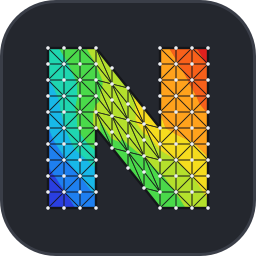
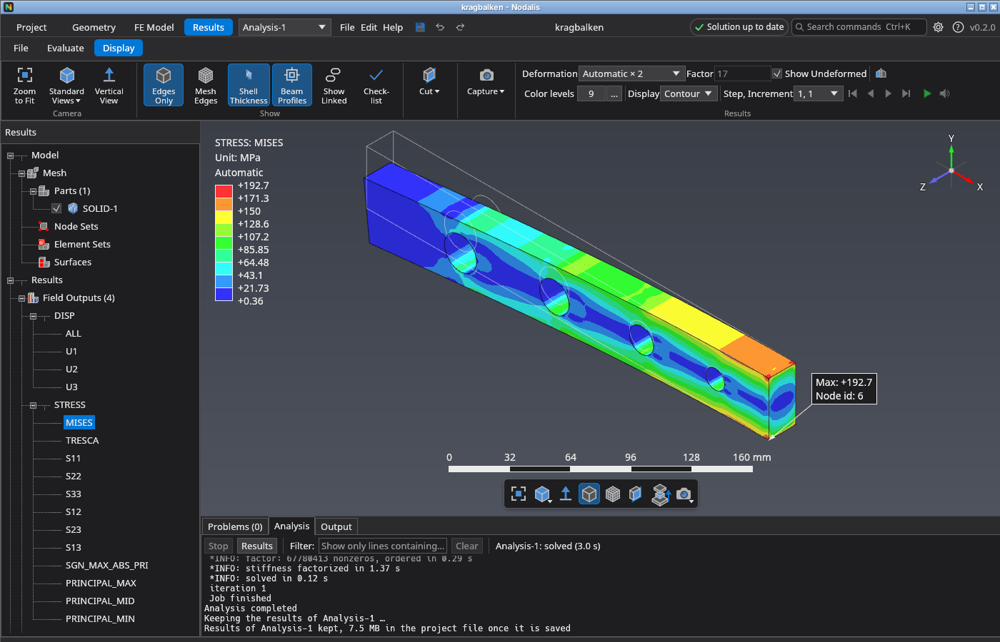

<p align="center">
  
</p>

<h1 align="center">Nodalis</h1>

Nodalis is a finite element program for structural and thermal analysis, written in Rust, for
**Linux and Windows**. A project is a graph of linked nodes: geometry and mesh sources, materials,
analyses, measurements and optimizers feed into each other, so variants, follow-up analyses and
parameter studies are wires instead of copied files. Inside an analysis you import a geometry, mesh
it, set up materials, contacts, loads and steps by picking on the model, solve and look at the
results, without editing input files by hand.

Nodalis comes with its own solver, written in Rust from scratch, that computes the analyses inside
the program: no external solver to install, and results go straight into the post-processing.



> Nodalis is a hobby project under active development. There is no release yet, so for now
> build it with cargo (see below). Expect rough edges and please report what you find in the
> [issue tracker](https://github.com/KwentiN-ui/Nodalis/issues).

## Features

**Project as a node graph**
- Analyses, geometry and mesh sources, material sets and cross-sections as blocks, linked by wires.
- Analyses build on each other (follow-up steps, restarts) and share geometry, mesh and materials.
- Expose parameters, measure results and let an optimizer or a Campbell sweep run the loop.

**Geometry and mesh**
- Import STEP, IGES and BREP geometry, or open an existing `.inp` mesh.
- Tetrahedral meshing (1st and 2nd order) with [Gmsh](https://gmsh.info/): per-part meshing
  parameters and local mesh sizes on faces and edges.
- Mesh tools: merge nodes, mirror, transform, renumber.
- 2D models (plane stress, plane strain, axisymmetric), shells, beams and trusses.

**Model setup**
- Materials (elastic, plastic, thermal) with a material library; solid, shell and beam sections.
- Boundary conditions, loads (pressure, surface and body loads, centrifugal, moments), amplitudes,
  initial conditions and defined fields.
- Contact regions detected automatically, ties, constraints, rigid bodies, bolts with
  pre-tension, submodeling.
- Node and element sets are created implicitly from your selection.
- Unit systems with unit-aware input and model check.

**Analysis**
- Static, frequency, buckling, dynamic, modal dynamics, steady-state dynamics, heat transfer and
  coupled temperature-displacement steps, complex frequency with Campbell diagram.
- Built-in solver with direct and iterative equation solvers and live progress; results stay in
  the program.

**Post-processing**
- Contour plots, deformed shapes, section views, animations and mode shapes.
- Derived field and history outputs, paths, planes, hot-spot search and result queries.
- Screenshots to file or clipboard.

Projects are saved as `.ndl` files.

## Installation

For geometry import and meshing Nodalis needs Gmsh. The Windows installer and the Linux AppImage
bundle it, see the sections below.

### Windows

Download `nodalis-<version>-setup.exe` from the
[latest release](https://github.com/KwentiN-ui/Nodalis/releases/latest) and run it. It installs
Nodalis with a Start menu entry, bundles Gmsh and can associate `.ndl` project files.

### Linux

Download `nodalis-<version>-x86_64.AppImage` from the
[latest release](https://github.com/KwentiN-ui/Nodalis/releases/latest), make it executable and
start it:

```sh
chmod +x nodalis-*-x86_64.AppImage
./nodalis-*-x86_64.AppImage
```

The AppImage bundles Gmsh and runs on x86_64 distributions with glibc 2.35 or newer (Ubuntu 22.04,
Debian 12, Fedora 36 and later). To get a menu entry and open `.ndl` files by double-click, integrate
it with a tool such as [Gear Lever](https://flathub.org/apps/it.mijorus.gearlever) or
[AppImageLauncher](https://github.com/TheAssassin/AppImageLauncher). The AppImage carries update
information, so these tools can also update it to the latest release.

#### Alternative: install with cargo

Any distribution works with one command, straight from the Git repository, without cloning. You
need a current stable Rust toolchain ([rustup](https://rustup.rs/)):

```sh
cargo install --git https://github.com/KwentiN-ui/Nodalis plx-app
```

This builds the `nodalis` program and puts it in `~/.cargo/bin`. The first build takes a few
minutes. Building needs the ALSA development files (Debian/Ubuntu: `sudo apt install libasound2-dev pkg-config`,
Fedora: `sudo dnf install alsa-lib-devel`). At run time Linux needs `libxkbcommon-x11` (X11) or
`libxkbcommon` (Wayland) and a Vulkan or OpenGL driver, which most desktops already have.

Unlike the AppImage, this does not include Gmsh, see [Gmsh](#gmsh-for-cargo-install-and-source-builds) below.
To update later, run the same command again with `--force`. To build from a clone instead, see
[docs/DEVELOPMENT.md](docs/DEVELOPMENT.md).

### Gmsh for cargo install and source builds

Nodalis imports STEP, IGES and BREP geometry and meshes it with [Gmsh](https://gmsh.info/). Gmsh is
not part of Nodalis and is loaded as a library at run time. The Windows installer and the Linux
AppImage bundle it, so this section only applies if you installed with cargo or built from source.
**Without Gmsh** Nodalis starts and works normally, but geometry import and meshing are not available. Opening `.inp` meshes, model setup,
solving and post-processing do not need it.

On Linux, the simplest way is to take the official library (Gmsh 4.15, the tested version) from its
PyPI package and put it next to the program. No clone and no Python packages are needed beyond `pip`:

```sh
pip download gmsh==4.15.2 --no-deps --only-binary=:all: --platform manylinux_2_24_x86_64 -d /tmp/gmsh
mkdir -p ~/.cargo/bin/gmsh
unzip -j /tmp/gmsh/gmsh-4.15.2-*.whl '*/lib/libgmsh.so.4.15' '*/doc/gmsh/LICENSE.txt' -d ~/.cargo/bin/gmsh
mv ~/.cargo/bin/gmsh/LICENSE.txt ~/.cargo/bin/gmsh/GMSH-LICENSE.txt
```

The library also needs `libGLU` and `libXft` (Debian/Ubuntu: `sudo apt install libglu1-mesa libxft2`).
Nodalis looks for the library, in this order, at the path set in *Tools > Settings > Gmsh*, in the
environment variable `NODALIS_GMSH`, next to the program and in its `gmsh` subfolder, and finally in
the system library path. If you already have Gmsh installed (for example `libgmsh` from your
distribution), point the setting or `NODALIS_GMSH` to it; other Gmsh 4 versions may work but are
not tested. The *Test Gmsh* button in the settings loads the library and meshes a cube. From a clone,
`python3 scripts/fetch_gmsh.py` does the same, see [docs/DEVELOPMENT.md](docs/DEVELOPMENT.md#gmsh).

## Documentation

The **User Guide** is a PDF attached to every [release](https://github.com/KwentiN-ui/Nodalis/releases/latest)
(`nodalis-<version>-user-guide.pdf`). It starts with a first analysis step by step and then
describes every dialog and how the model is solved. The source is in
[docs/user-guide/](docs/user-guide/).

## Contributing and development

Building from source, project layout, tests and releases are described in
[docs/DEVELOPMENT.md](docs/DEVELOPMENT.md).

## License

Nodalis is licensed under the GPL-3.0-or-later, see [LICENSE](LICENSE).

Parts of the workflow and several defaults were inspired by [PrePoMax](https://prepomax.fs.um.si/)
(GPL-3.0) by Matej Borovinšek; thanks to the PrePoMax project.

Gmsh is licensed under the GPL-2.0-or-later with an exception for OpenCASCADE, Netgen and METIS,
and OpenCASCADE under the LGPL-2.1 with exception; both are compatible with the GPL-3.0. If you
distribute Nodalis together with the Gmsh library, include `GMSH-LICENSE.txt` and point to the
sources: Gmsh at <https://gitlab.onelab.info/gmsh/gmsh> (tag `gmsh_4_15_2`), OpenCASCADE at
<https://github.com/Open-Cascade-SAS/OCCT>.

The bundled font Noto Sans (`crates/plx-app/assets/fonts`, reduced to Latin, Greek and common
symbols) is licensed under the SIL Open Font License 1.1, see
[OFL.txt](crates/plx-app/assets/fonts/OFL.txt).
